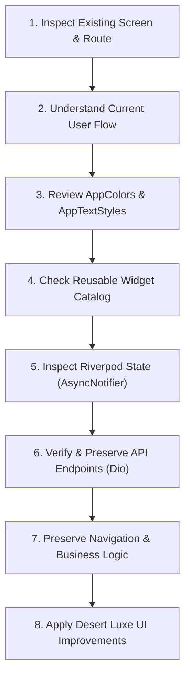

# Al Sewar Auto Center — Premium UI/UX Design System Skill
**Design Language:** Desert Luxe  
**Target Applications:** Al Sewar Customer App & Al Sewar Manager App  
**Architecture:** Flutter 3.x · Riverpod `AsyncNotifier` · MVVM · Dio `ApiClient`

---

## 1. Project Context & Architectural Foundation

Al Sewar Auto Center is a **premium automotive service and loyalty platform**, not a generic car wash utility. The platform encompasses vehicle management, live service tracking, branches and service centres, loyalty rewards, tiered vouchers, customer profiles, and operational management.

### The Two Applications
1. **Al Sewar Customer App:** Customer-facing mobile application emphasizing luxury automotive care, seamless service booking, real-time vehicle progress, transparent loyalty balances, and exclusive member privileges.
2. **Al Sewar Manager App:** Operational management platform for branch supervisors, managers, and service advisors to monitor live bay queues, assign technicians, update service milestones, and review branch performance.

> [!IMPORTANT]
> Both applications share the **exact same brand identity, Desert Luxe color system, typography scale, component language, and visual quality**. Layouts and information density differ according to user workflows, but the visual luxury signature remains unified.

### Technology Stack
- **Framework:** Flutter 3.x (Dart 3.x, null-safe).
- **State Management:** Riverpod with `AsyncNotifier` / `AsyncNotifierProvider` for robust asynchronous state.
- **Architecture:** Feature-first MVVM (Model-View-ViewModel).
- **Networking:** Dio via centralized `ApiClient` (`lib/core/network/api_client.dart`).
- **Storage:** `TokenStorage` with `flutter_secure_storage` for JWT tokens.
- **Theme Files:** `lib/app/theme/app_colors.dart`, `lib/app/theme/app_text_styles.dart`, `lib/app/theme/app_theme.dart`.

---

## 2. Reference UI/UX Structural Inspiration

When reviewing structural reference layouts, emulate their **composition and hierarchy**, while strictly translating their visual expression into the **Al Sewar Desert Luxe** palette:

- **Screen Composition:** Balanced, uncluttered vertical flow with clear primary, secondary, and tertiary zones.
- **Header Arrangements:** Compact top app bar containing the Al Sewar emblem, unread notification bell, customer greeting, and profile avatar shortcut.
- **Loyalty Card Placement:** Positioned prominently in the top third of the viewport as the hero membership anchor.
- **Service Shortcut Grids:** Clean 4-column or 2x4 responsive grid of elevated category tiles with high-contrast icons and readable labels.
- **Promotional Carousels:** Horizontal swipeable card carousels with 0.92 viewport fraction and pill indicators.
- **Horizontal Deal Lists:** Curated horizontal package cards with distinct promotional tags (`EXCLUSIVE`, `POPULAR`, `BEST VALUE`).
- **Grouped Account Settings:** Modular, rounded card groups (e.g., `MY PROFILE`, `MY ACTIVITIES`, `SUPPORT & SETTINGS`) with consistent leading icons and subtle chevron trailing indicators.
- **Rewards Progression:** Gamified tier step trackers (Silver -> Gold -> Platinum) with dynamic points-to-next-tier calculations.
- **Bottom Navigation:** Rounded floating pill nav bar with dedicated bottom scroll clearance.

> [!WARNING]
> Reference layouts often feature generic blue accents or high-contrast tech blues. **Do NOT replicate blue color schemes, external logos, or third-party branding.** All structures must be rendered exclusively in the Desert Luxe palette.

---

## 3. Official Design System – Desert Luxe

All color values and gradients must be referenced through `AppColors` in `lib/app/theme/app_colors.dart`. **Never hardcode hex values in UI widgets.**

### 3.1 Core Color Tokens

| Token Name | Hex Code | Visual Role | Flutter Constant |
|---|---|---|---|
| **Warm Porcelain** | `#F6F2EA` | Scaffold background, soft ambient canvas | `AppColors.warmPorcelain` |
| **Deep Charcoal** | `#1C1C1B` | Primary text, luxury dark cards, primary buttons, header bars | `AppColors.deepCharcoal` |
| **Champagne Gold** | `#C6A66B` | Brand signature accent, loyalty highlights, active icons, tier badges | `AppColors.champagneGold` |
| **Sand Beige** | `#E9E0D2` | Card borders, subtle dividers, secondary surface fill | `AppColors.sandBeige` |
| **Pure White** | `#FFFFFF` | Card surfaces, form inputs, high-contrast text on charcoal | `AppColors.pureWhite` |

### 3.2 Semantic & Typography Tokens

| Token Name | Value | Purpose |
|---|---|---|
| `AppColors.textPrimary` | `#1C1C1B` (Deep Charcoal) | Primary headings, prominent titles, hero values |
| `AppColors.textSecondary` | `#636058` | Subtitles, descriptions, secondary metadata |
| `AppColors.textLight` | `#969083` | Captions, placeholders, disabled timestamps |
| `AppColors.success` | `#2E7D32` | Completed services, valid status, positive balance |
| `AppColors.error` | `#C62828` | Errors, cancellation, destructive actions |
| `AppColors.warning` | `#F57F17` | Pending notices, delays, expiring vouchers |
| `AppColors.info` | `#1976D2` | Informational announcements |

### 3.3 Metallic Gradients

- **Gold Gradient (`AppColors.goldGradient`):**
  - Colors: `#DEC595` (bright highlight) -> `#C6A66B` (core brand gold) -> `#A88849` (deep rich gold).
  - Direction: `Alignment.topLeft` to `Alignment.bottomRight`.
  - Usage: Loyalty tier badges, primary CTA button surfaces, milestone checkmarks.
- **Charcoal Gradient (`AppColors.charcoalGradient`):**
  - Colors: `#2C2C29` (subtle lighter top highlight) -> `#1C1C1B` (deep brand charcoal).
  - Direction: `Alignment.topLeft` to `Alignment.bottomRight`.
  - Usage: Premium loyalty cards, hero cards, dark promotional cards.
- **Gold Radial Gradient (`AppColors.goldRadialGradient`):**
  - Center: `Alignment.topLeft`, Radius: `1.5`.
  - Usage: Circular badges, hero avatar frames, VIP medal backgrounds.

### 3.4 Elevation, Shadows & Glows

```dart
// Ambient, ultra-soft luxury shadow for white cards on warm porcelain
static const List<BoxShadow> softShadow = [
  BoxShadow(color: Color(0x0A1C1C1B), blurRadius: 10, offset: Offset(0, 3)),
];

// Medium depth shadow for elevated containers and modal sheets
static const List<BoxShadow> cardShadow = [
  BoxShadow(color: Color(0x101C1C1B), blurRadius: 12, offset: Offset(0, 4)),
];

// Subtle metallic gold illumination for VIP badges and selected items
static const List<BoxShadow> goldGlow = [
  BoxShadow(color: Color(0x28C6A66B), blurRadius: 12, offset: Offset(0, 4)),
];
```

---

## 4. Typography System

The application registers two distinct Google fonts in `pubspec.yaml`:
1. **Manrope** for authoritative, luxurious headings, section titles, and numerical metrics.
2. **DM Sans** for crisp, comfortable, legible body copy, button labels, and metadata.

All styles are centralized in `lib/app/theme/app_text_styles.dart`:

| Style Constant | Font Family | Size | Weight | Tracking | Primary Usage |
|---|---|---|---|---|---|
| `AppTextStyles.display` | Manrope | 30px | Bold (w700) | -0.5 | Splash branding, hero metrics |
| `AppTextStyles.heading` | Manrope | 24px | Bold (w700) | -0.2 | Screen titles, modal sheet headers |
| `AppTextStyles.sectionHeading` | Manrope | 18px | Semibold (w600) | -0.1 | Section headers ("Our Services", "Featured Offers") |
| `AppTextStyles.title` | Manrope | 18px | Semibold (w600) | +0.1 | Card primary titles, branch names |
| `AppTextStyles.cardTitle` | Manrope | 15px | Semibold (w600) | +0.1 | Grid item labels, offer card titles |
| `AppTextStyles.loyaltyPoints` | Manrope | 30px | Bold (w700) | -0.5 | Points balance counters (Champagne Gold) |
| `AppTextStyles.bodyPrimary` | DM Sans | 14px | Regular (w400) | +0.2 | Main descriptions, form field text |
| `AppTextStyles.bodySecondary` | DM Sans | 13px | Regular (w400) | +0.2 | Supporting copy, timestamps, addresses |
| `AppTextStyles.supporting` | DM Sans | 12px | Regular (w400) | +0.2 | Form helper labels, status subtext |
| `AppTextStyles.button` | DM Sans | 14px | Semibold (w600) | +0.5 | Elevated & outlined button labels |
| `AppTextStyles.caption` | DM Sans | 11px | Regular (w400) | +0.2 | Legal disclaimers, micro metadata |
| `AppTextStyles.emphasis` | DM Sans | 13px | Italic (w400) | +0.2 | Subtle quotes, brand taglines |

> [!TIP]
> Never invent arbitrary font sizes or weights in widget files. If a new typography style is legitimately required, add it directly to `AppTextStyles`.

---

## 5. Premium Glossy Visual Direction

Al Sewar interfaces must reflect the refined craftsmanship of high-end automotive brands (Porsche, Aston Martin, Bentley). The visual signature combines **Deep Charcoal**, **Champagne Gold**, **subtle specular reflections**, and clean **Warm Porcelain** surfaces.

### 5.1 Glossy Implementation Rules
1. **Subtle Reflective Highlights:** Luxury surfaces use a 1px border with `AppColors.champagneGold.withValues(alpha: 0.22)` or a delicate top-edge specular gradient to simulate an automotive clear coat.
2. **Layered Surfaces:** Build depth through tone:
   - Base Canvas: `AppColors.warmPorcelain`.
   - Primary Cards: `AppColors.pureWhite` with 1px `AppColors.sandBeige` border and `AppColors.cardShadow`.
   - Hero Surfaces: `AppColors.charcoalGradient` with gold perimeter border and `AppColors.softShadow`.
3. **Metallic Champagne Gold Accents:** Gold is used purposefully for high-value signals (VIP tiers, coin totals, active navigation indicators, primary CTA buttons). It must never look neon, yellow, or brassy.
4. **Restraint & Legibility:**
   - **No universal glassmorphism:** Do not place `BackdropFilter` blurs across the whole app. It tanks rendering speed and degrades contrast.
   - **No muddy drop shadows:** Use low-opacity charcoal shadows (`0x0A` to `0x10`).
   - **Readability first:** High-contrast text is non-negotiable. Charcoal text on Porcelain/White; Pure White or Gold text on Charcoal.

For detailed recipes and code patterns, consult the [Glossy Surfaces Guide](./references/glossy_surfaces_guide.md).

---

## 6. Layout & Responsive Design Standards

Mobile devices vary widely from compact 320px screens to large 430px+ phablets. Every screen must adapt fluidly without overflow bugs or awkward whitespace.

### 6.1 Spatial Grid & Metrics
- **Horizontal Screen Padding:** Standard `20.0px` (reduce to `14.0px` on screens `< 360px` width).
- **Vertical Spacing Scale:**
  - Micro: `4.0px` / `8.0px` (icon-to-text, badge padding).
  - Tight: `12.0px` (spacing between related list items).
  - Medium: `16.0px` (card internal padding, form field gaps).
  - Sectional: `24.0px` (space between distinct sections).
  - Major: `32.0px` (distance between major layout blocks).
- **Border Radii:**
  - Standard Cards: `16.0px` to `18.0px`.
  - Category / Grid Tiles: `12.0px` to `14.0px`.
  - Badges & Buttons: `10.0px` to `12.0px`.
  - Floating Nav Bars & Full Pills: `30.0px` to `36.0px`.

### 6.2 Responsive Guidelines
- **Bottom Navigation Clearance:** Always pad scrollable content by the nav bar height using:
  ```dart
  final bottomClearance = FloatingPillNavBarUtils.calculateBottomClearance(
    context,
    clearance: 32.0,
  );
  ```
- **Text Safety:** Always assign `maxLines` and `overflow: TextOverflow.ellipsis` to text inside flexible rows, headers, and cards.
- **Scroll Physics:** Use `SingleChildScrollView(physics: const AlwaysScrollableScrollPhysics())` combined with `RefreshIndicator` on dashboard views.
- **Wrap with SafeArea:** Never allow content to collide with notches, camera punch-holes, or home indicator bars.

---

## 7. Reusable Component Catalog

Always consult the [Component Catalog](./references/component_catalog.md) before writing new UI components. Existing components include:

1. **`LoyaltyCard`** (`lib/features/home/widgets/loyalty_card.dart`): Reusable membership card supporting user name, tier, coin balance, and animated progress to next tier.
2. **`FloatingPillNavBar`** (`lib/features/home/widgets/floating_pill_nav_bar.dart`): Floating navigation pill with sliding white indicator, Sand Beige inactive icons, and Gold active accents.
3. **`HomeHeader`** (`lib/features/home/widgets/home_header.dart`): Top bar with branded emblem, customer greeting, and unread notification badge.
4. **`ServiceCategories`** (`lib/features/home/widgets/service_categories.dart`): Responsive 4-column service shortcut grid wired to `customerServicesProvider`.
5. **`PromotionalBanner`** (`lib/features/home/widgets/promotional_banner.dart`): Swipeable carousel for seasonal campaigns and member reward announcements.
6. **`FeaturedOffers`** (`lib/features/home/widgets/featured_offers.dart`): Horizontal cards displaying bundled auto detailing packages.
7. **`BranchDetailsBottomSheet`** (`lib/features/branches/widgets/branch_details_bottom_sheet.dart`): Modal bottom sheet with branch details, directions, phone call, and WhatsApp concierge actions.

---

## 8. Screen-Specific UX Guidance

Detailed screen architectures are documented in [Screen Blueprints](./references/screen_blueprints.md). Key rules per screen:

### 8.1 Home Dashboard
- Compact `HomeHeader` -> `LoyaltyCard` -> `ServiceCategories` (4-column grid) -> `PromotionalBanner` (carousel) -> `ActiveVisitTracker` -> `FeaturedOffers` -> Safe bottom clearance.

### 8.2 Rewards & Loyalty
- Tier status header -> Glossy points balance counter (`AppTextStyles.loyaltyPoints`) -> Tier progression milestone track -> Voucher collection cards with dashed coupon borders -> Points redemption history.

### 8.3 Profile & Account
- Avatar header card with tier chip -> Grouped settings cards (`MY PROFILE`, `MY ACTIVITIES`, `SUPPORT & SETTINGS`) -> Consistent leading icons & trailing chevrons -> Destructive sign-out modal.

### 8.4 Service Visits & Milestones
- Tab switcher (Active / Past) -> Visit card with `SV-...` reference, stage badge, vehicle info -> Vertical chronological milestone timeline with gold pulsing active node -> Invoice download button.

### 8.5 Branches & Service Centres
- Map/List toggle -> Clean branded map with gold pins -> Branch card with live operating hours tag ("Open Now" / "Closed") -> Interactive bottom sheet with WhatsApp concierge integration.

### 8.6 Manager Operational Views
- High-clarity operational dashboard -> Bay status grid -> Real-time vehicle check-in modal -> Quick technician assignment -> KPI metrics (Bays Active, Queue, Completed, Daily Revenue).

---

## 9. Mandatory Flutter Implementation & Architectural Rules

Before touching or authoring any screen, follow this mandatory 8-step workflow:



### Cardinal Rules
1. **Never break working functionality:** Visual upgrades must not alter underlying business logic, state mutations, or navigation parameters.
2. **Never mock existing live APIs:** If an endpoint is already integrated (`AuthService`, `BranchService`, `VehicleService`, `VisitApiService`, `ReviewService`), consume real data via its Riverpod provider.
3. **Never place business logic in widgets:** Keep controllers, API calls, and data mapping in the ViewModel layer. UI widgets should only watch state and dispatch intents.
4. **Always handle all `AsyncValue` states:**
   ```dart
   final asyncData = ref.watch(myProvider);
   return asyncData.when(
     data: (data) => _buildContent(data),
     loading: () => const Center(child: CircularProgressIndicator(color: AppColors.champagneGold)),
     error: (err, stack) => _buildErrorState(err),
   );
   ```
5. **Enforce `const` constructors:** Use `const` wherever possible to minimize widget rebuilds and optimize frame rates.

---

## 10. UI Quality & Verification Checklist

Before completing any UI task, run through this verification checklist:

- [ ] **Color Fidelity:** All colors use `AppColors` tokens. Zero hardcoded hex values in screens.
- [ ] **Typography:** All text styles use `AppTextStyles` (Manrope for headings/metrics, DM Sans for body/controls).
- [ ] **Glossy Restraint:** Metallic champagne gold and charcoal gradients are used selectively for hero elements, not plastered across every container.
- [ ] **Screen Margins:** Consistent `20px` horizontal screen padding applied.
- [ ] **Bottom Clearance:** Scrollable views include bottom clearance for the floating navigation pill.
- [ ] **No RenderFlex Overflows:** Tested in portrait mode; flexible texts wrapped in `Expanded`/`Flexible` with `TextOverflow.ellipsis`.
- [ ] **Touch Targets:** All interactive icons and buttons meet the minimum `44x44px` touch target size.
- [ ] **State Coverage:** Loading indicators use `AppColors.champagneGold`; empty states offer actionable messages; error states provide retry buttons.
- [ ] **Static Analysis:** Code passes `flutter analyze` without introduced warnings or lint violations.
- [ ] **Formatting:** Files are formatted cleanly using standard Dart conventions.

---

## 11. Design Philosophy Summary

> *"Al Sewar does not look like a generic Flutter utility. It looks and feels like an exclusive automotive salon."*

The visual identity is defined by the contrast between **warm, clean porcelain backgrounds**, **deep charcoal architectural elements**, **refined metallic champagne gold accents**, and **subtle specular reflections**. Every screen must exude prestige, modern engineering, and uncompromising quality.
